# Plano do Escala: fundação completa

**Status:** plano aprovado em 04/11/2026. Fases 1 e 2 concluídas. O esquema real, sempre atualizado, fica em [DATA_DICTIONARY.md](DATA_DICTIONARY.md).
**Base:** [PROMPT_ESCALA.md](PROMPT_ESCALA.md), com a alteração de escopo da seção 2.
**Versões e fontes:** verificadas em 04/11/2026 (seção 16).

## 1. Resumo

O Escala passa de um protótipo web (Express, SQLite e React) para um app nativo iOS e Android, com API em NestJS e PostgreSQL. A base técnica muda porque o prompt exige o que ela não oferece: RLS, PostGIS, Keychain, push e login nativo. As regras de negócio e de privacidade já testadas são portadas, e os 84 testes atuais viram especificação de aceite.

Decisões que mais afetam o projeto:

| Decisão                                                 | Motivo                                                                  | Registro                                                        |
| ------------------------------------------------------- | ----------------------------------------------------------------------- | --------------------------------------------------------------- |
| **Sem pagamentos no app**                               | Decisão sua. Elimina custódia, PCI e regulação de pagamentos            | [ADR-0001](adr/0001-sem-pagamentos-no-app.md)                   |
| **App nativo em Expo e aposentadoria do protótipo web** | A web não oferece Keychain, biometria e push confiáveis                 | [ADR-0002](adr/0002-app-nativo-e-migracao-do-prototipo.md)      |
| **Monorepo e monolito modular em NestJS**               | Um produto, uma equipe pequena e muitos domínios                        | [ADR-0003](adr/0003-monorepo-e-monolito-modular.md)             |
| **PostgreSQL 18, PostGIS, Drizzle e migrações em SQL**  | RLS e geolocalização no banco. O Drizzle não gera migrações de reversão | [ADR-0004](adr/0004-postgresql-drizzle-e-migracoes-sql.md)      |
| **Autorização em duas camadas: RBAC e RLS**             | Um erro na API não pode expor dados de outra pessoa                     | [ADR-0005](adr/0005-autorizacao-rbac-e-rls.md)                  |
| **Criptografia por campo com chave em KMS**             | O banco nunca recebe a chave de decifrar                                | [ADR-0006](adr/0006-criptografia-por-campo.md)                  |
| **Login sem senha**                                     | Sem senha não há o que vazar nem o que reutilizar                       | [ADR-0007](adr/0007-login-sem-senha-e-tokens.md)                |
| **Sem biometria obrigatória**                           | Sem pagamentos, selfie e documento deixam de ser necessários            | [ADR-0008](adr/0008-verificacao-de-identidade.md)               |
| **TypeScript 6, ESLint e validação própria**            | Decidido na Fase 1: as ferramentas ainda não suportam o TypeScript 7    | [ADR-0009](adr/0009-typescript-6-eslint-e-validacao-propria.md) |
| **Serviços locais**                                     | Decidido na Fase 1: imagem ARM do PostGIS, e MinIO arquivado            | [ADR-0010](adr/0010-servicos-locais.md)                         |

## 2. Alteração de escopo: sem pagamentos pelo app

Por sua decisão em 04/11/2026, o app não cobra, não retém e não repassa dinheiro. A empresa paga o freelancer diretamente, fora do app, e o Escala apenas registra o valor combinado. A Fase 5 foi cancelada. A numeração das demais não muda, para manter as referências ao prompt.

| Requisito original                                                                                                | Como fica                                                                                                                                 |
| ----------------------------------------------------------------------------------------------------------------- | ----------------------------------------------------------------------------------------------------------------------------------------- |
| §2.3 `payments`, `payment_splits`, `payouts`, `refunds`, `ledger_entries`, `payment_webhook_events`, `recipients` | Não serão criadas                                                                                                                         |
| §2.1 Ledger em partidas dobradas                                                                                  | Removido. Dinheiro aparece só como valor combinado, em centavos (`bigint`) com `currency`                                                 |
| §2.1 Máquina de estado de pagamento                                                                               | Removida. Ficam as de vaga, candidatura, contrato, turno, disputa e chamado                                                               |
| §2.1 `idempotency_keys`                                                                                           | Mantida para repetições em conexão ruim: publicar vaga, aceitar contrato e enviar mensagem                                                |
| §2.2 Dados de cartão                                                                                              | O app não coleta dado de cartão nem bancário                                                                                              |
| §3 Biometria para confirmar pagamentos                                                                            | Biometria protege a reabertura do app e as ações sensíveis                                                                                |
| §3 Selfie e documento antes de receber pagamentos                                                                 | Vira selo opcional. CPF e data de nascimento continuam ([ADR-0008](adr/0008-verificacao-de-identidade.md))                                |
| §4 Pagamentos com Pagar.me                                                                                        | Removida por inteiro                                                                                                                      |
| §5.1 Aviso de que pagamento fora do app perde proteção                                                            | Não se aplica. Fica a máscara de contato antes do contrato, por privacidade, e o alerta contra golpes, como pedido de pagamento adiantado |
| §5.1 Mensagem "pagamento liberado"                                                                                | Vira "pagamento marcado como feito" e "pagamento confirmado"                                                                              |
| §5.2 Categoria de chamado "pagamento"                                                                             | Vira "combinado e pagamento". O suporte não executa nem garante valores                                                                   |
| §5.2 Execução financeira da disputa                                                                               | A decisão afeta o contrato e a reputação. Nenhum dinheiro é movimentado                                                                   |
| §5.3 Selo "pagadora rápida" e "pagamentos em dia"                                                                 | Calculados pela confirmação do freelancer (seção 8.2)                                                                                     |
| §5.4 Só contrato pago pode avaliar                                                                                | Só contrato concluído, com proteções contra conluio (seção 8.3)                                                                           |
| §5.4 Penalidade por atraso no pagamento                                                                           | Só depois de disputa decidida                                                                                                             |
| §5.5 Compensação por cancelamento e falta                                                                         | Só efeitos de reputação                                                                                                                   |
| §5.5 GMV e take rate                                                                                              | Viram valor combinado registrado e contratos concluídos. Take rate não existe sem cobrança                                                |
| §6 Pagar com Pix e biometria, selo "pagamento protegido"                                                          | Removidos. A confiança vem de verificação, valor registrado e histórico                                                                   |
| §6 Fluxo de contratação e pagamento                                                                               | Vira contratação e registro do combinado                                                                                                  |
| §8 Cobertura de 80% em pagamento e ledger                                                                         | Vale para auth, reputação, máquinas de estado e autorização                                                                               |
| §9 Fases 5, 7 e 8                                                                                                 | Fase 5 cancelada. Critérios das fases 7 e 8 ajustados (seção 11)                                                                          |

**O que melhora:** não há custódia de dinheiro de terceiros, escopo PCI, Mecanismo Especial de Devolução do Pix, emissão de nota sobre taxa nem infraestrutura de pagamentos.

**O que piora, e precisa ficar claro:**

1. **Não há receita no plano.** Sem cobrança, o modelo de negócio fica em aberto (decisão D1).
2. **O Escala não protege contra calote.** O app e os termos precisam dizer isso com clareza.
3. **Contrato falso fica barato.** Sem dinheiro real em jogo, é mais fácil inventar contratos para inflar reputação (seção 8.3).

## 3. Estado atual e o que aproveitar

O repositório tem cerca de 6.600 linhas, sem `CLAUDE.md` e sem git até esta fase. O protótipo funciona, mas não tem dados reais a migrar: só contas fictícias.

| O que existe                                                                                                    | Destino                                        | Por quê                                                 |
| --------------------------------------------------------------------------------------------------------------- | ---------------------------------------------- | ------------------------------------------------------- |
| `client/` (React web, PWA)                                                                                      | Referência até a paridade. Removido na Fase 9  | Substituído pelo app nativo                             |
| `server/routes/*` (Express)                                                                                     | Regras portadas para módulos NestJS            | Regras continuam, estrutura muda                        |
| `node:sqlite`                                                                                                   | Substituído por PostgreSQL                     | SQLite não tem RLS nem PostGIS                          |
| `server/vault.ts`                                                                                               | Lógica portada, com chave em KMS               | Cifra amarrada ao campo e índice cego já estão testados |
| `server/codes.ts`                                                                                               | Portado como base do login por código          | Já tem HMAC, limite de tentativas e de envio            |
| `server/mail.ts`                                                                                                | Portado                                        | Textos sem links e sem dados pessoais                   |
| Máscara de contato, liberação em 30 dias, registro de consentimento, histórico de acesso, exportação e exclusão | Portados como comportamento de produto         | São o diferencial de privacidade                        |
| Senhas, recuperação e bloqueio por senha                                                                        | Aposentados                                    | O prompt pede login social e por código                 |
| `server/test/*` (84 testes)                                                                                     | Cada cenário vira teste de integração          | Nenhuma proteção se perde na migração                   |
| Identidade visual (cartões de ingresso, paleta)                                                                 | Vira tokens em `packages/ui`                   | Mantém a identidade e evolui para o padrão de 2026      |
| `docs/LGPD.md`, `docs/SEGURANCA.md`                                                                             | Atualizados. `SEGURANCA.md` vira `SECURITY.md` | O prompt pede o modelo de ameaças nesse arquivo         |

O papel fixo `users.role` também muda: a mesma pessoa poderá trabalhar como freelancer e ser membro de uma empresa.

## 4. Stack

| Camada               | Escolha                         | Versão atual              | Observação                                                                                                                      |
| -------------------- | ------------------------------- | ------------------------- | ------------------------------------------------------------------------------------------------------------------------------- |
| Mobile               | Expo, React Native, Expo Router | SDK 58 (58.0.23), RN 0.88 | Usar `--template default@sdk-58` com development build: `create-expo-app` ainda cria SDK 57 até o novo Expo Go sair             |
| Estado e dados       | TanStack Query, Zustand         | 5.106, 5.0                |                                                                                                                                 |
| Backend              | NestJS sobre Express, Node 24   | 12.3                      |                                                                                                                                 |
| Validação e contrato | Zod, `@nestjs/swagger`          | 4.6, 12.1                 | Schemas em `packages/shared`, camada própria e OpenAPI gerado ([ADR-0009](adr/0009-typescript-6-eslint-e-validacao-propria.md)) |
| Banco                | PostgreSQL com PostGIS          | 18 (3.6)                  | `uuidv7()` nativo. O prompt pede 16 ou superior                                                                                 |
| Acesso a dados       | Drizzle                         | 0.45                      | Tem `pgPolicy` e tipos PostGIS. Ainda está em versão 0.x                                                                        |
| Migrações            | `node-pg-migrate`, em SQL       | 9.0                       | Up e down de primeira classe                                                                                                    |
| Filas e cache        | Redis, BullMQ                   | 6.7                       | Notificações e tarefas agendadas                                                                                                |
| Tempo real           | Socket.IO com adaptador Redis   | 4.8                       | Chat, leitura e digitação                                                                                                       |
| Arquivos             | S3 com URLs assinadas           |                           | SeaweedFS em desenvolvimento ([ADR-0010](adr/0010-servicos-locais.md))                                                          |
| Push                 | Expo Notifications              |                           |                                                                                                                                 |
| Observabilidade      | Sentry, pino, OpenTelemetry     | 8.33, 10.4, 0.300         | Logs sem dados pessoais                                                                                                         |
| Monorepo             | pnpm, Turborepo                 | 12.16, 2.11               |                                                                                                                                 |
| Linguagem e lint     | TypeScript, ESLint              | 6.0, 10.14                |                                                                                                                                 |
| CI e builds          | GitHub Actions, EAS             |                           | Precisa de repositório remoto (D4)                                                                                              |

O TypeScript 7 foi avaliado na Fase 1 e ficou de fora por incompatibilidade com o `typescript-eslint` ([ADR-0009](adr/0009-typescript-6-eslint-e-validacao-propria.md)).

## 5. Arquitetura

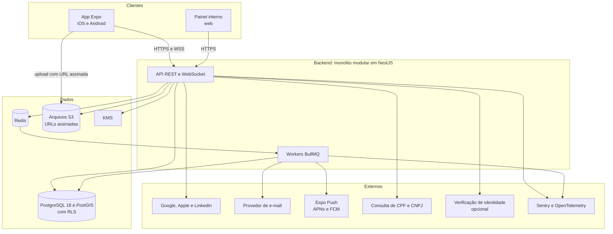

```text
apps/mobile        App Expo
apps/api           API e workers NestJS, migrações e seeds
apps/admin         Painel interno de suporte e moderação (Fase 8)
packages/ui        Design system: tokens e componentes
packages/shared    Tipos, schemas Zod, constantes e máquinas de estado
legacy/prototype   Protótipo atual, até a Fase 9
docs/              Plano, ADRs, dicionário de dados e regras
```

**Módulos da API:** `auth`, `users`, `companies`, `freelancers`, `jobs`, `contracts`, `shifts`, `messaging`, `notifications`, `reviews`, `reputation`, `support`, `disputes`, `moderation`, `privacy` e `platform` (flags e auditoria). Cada módulo só acessa as tabelas do outro pela interface pública dele.

**Integrações por interface, com mock:** login social, e-mail, push, CPF e CNPJ, identidade, arquivos e KMS. Sem credencial, o mock roda e eu aviso, como pede o prompt.

## 6. Modelo de dados

### 6.1 Regras aplicadas a todas as tabelas

- **IDs:** `uuid` v7 gerado por `uuidv7()`. O v7 revela a data de criação no próprio ID, o que é aceitável aqui.
- **Datas:** `timestamptz` em UTC.
- **Colunas padrão:** `created_at`, `updated_at` e `created_by`. Omitidas nos diagramas. Tabelas somente de inclusão, como `audit_logs` e os históricos, não têm `updated_at`, e um gatilho impede alterá-las.
- **Dinheiro:** `bigint` em centavos com `currency` e `CHECK` de valor não negativo.
- **Integridade:** `FOREIGN KEY`, `CHECK`, `UNIQUE`, `NOT NULL` e enums nativos.
- **Dono polimórfico:** quando o alvo pode ser pessoa ou empresa, são duas colunas com `FOREIGN KEY` e um `CHECK` exigindo exatamente uma preenchida. Isso preserva a integridade referencial.
- **Colunas `_enc`:** cifradas na aplicação. Colunas `_index`: HMAC para busca exata e unicidade (seção 6.6).
- **Exclusão:** `deleted_at` onde há valor histórico. Dados pessoais são apagados de verdade a pedido do titular.

### 6.2 Visão geral

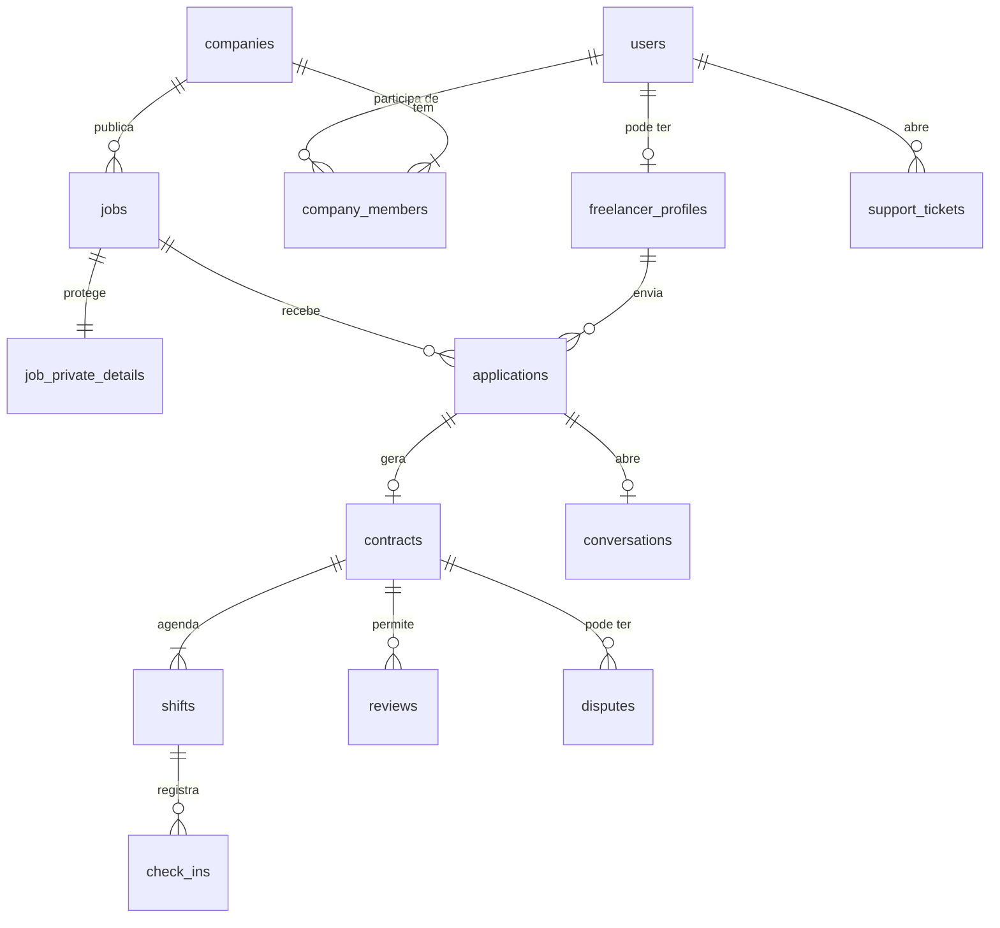

### 6.3 Diagramas por domínio

**Identidade e acesso**

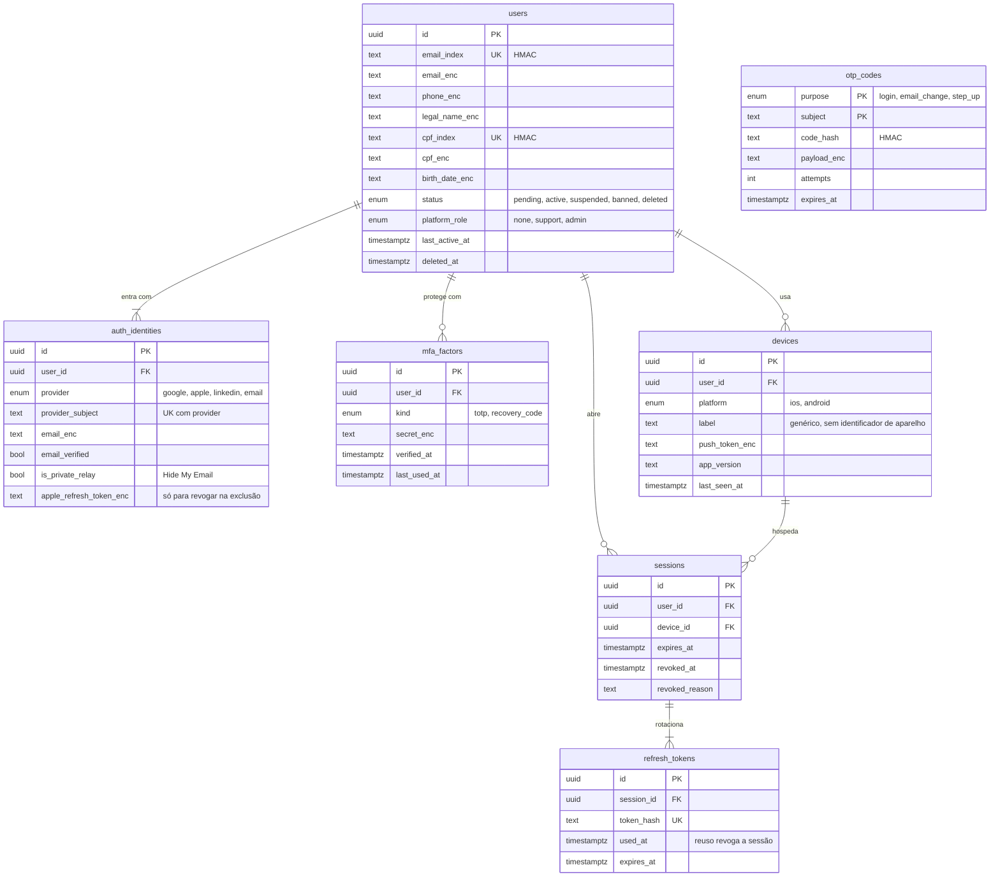

**Empresas**

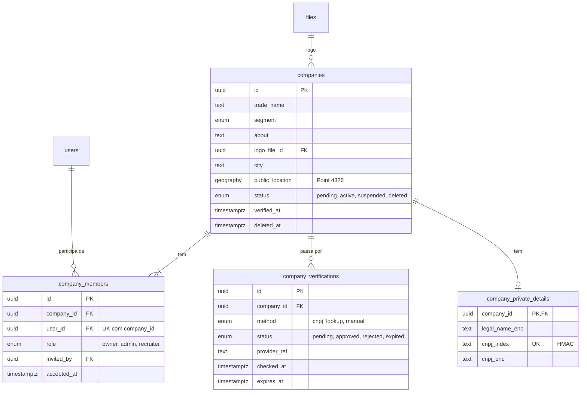

**Freelancers**

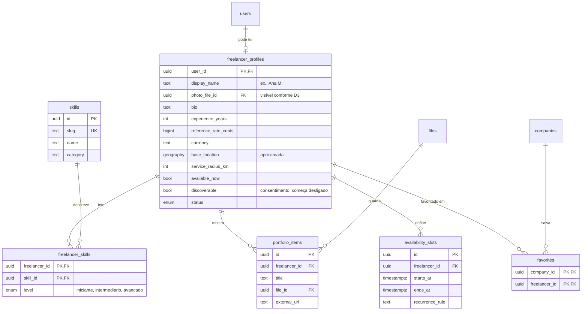

**Documentos e verificação**

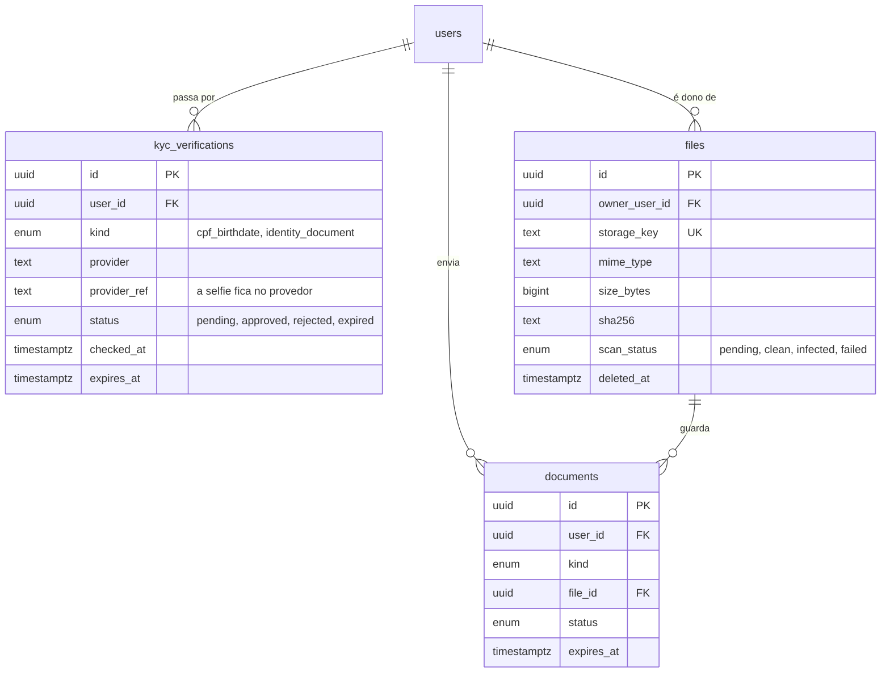

**Vagas, contratos e execução**

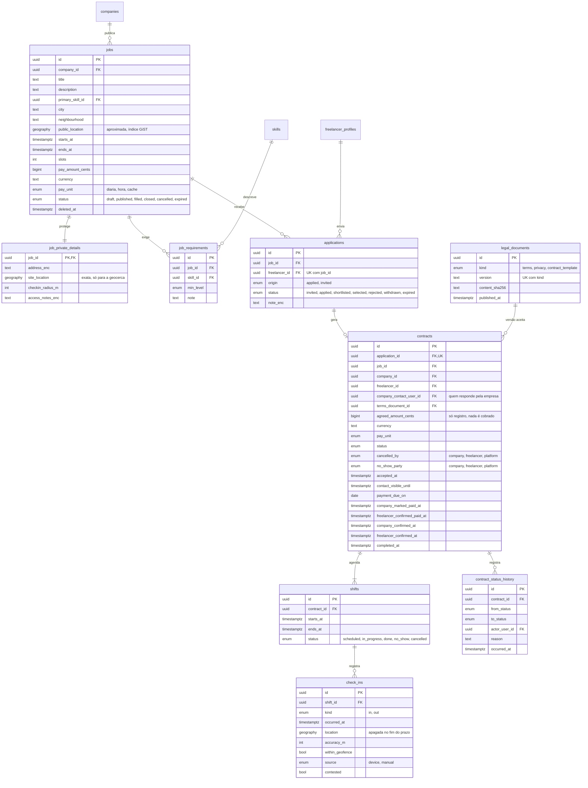

Tabelas `job_status_history`, `application_status_history`, `shift_status_history` e `ticket_status_history` seguem o mesmo padrão de `contract_status_history`.

**Conversas**

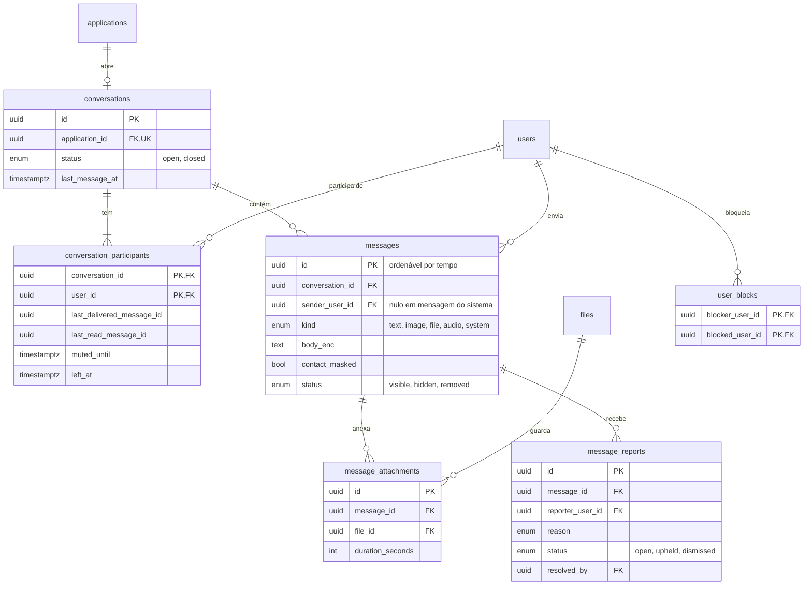

**Suporte e disputas**

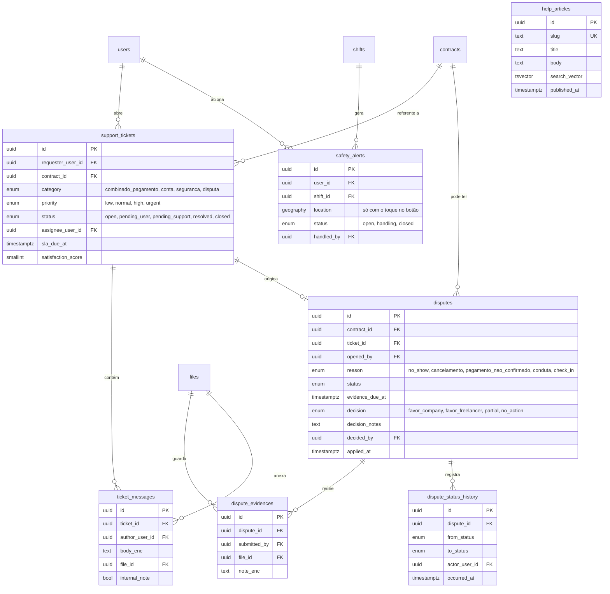

**Reputação**

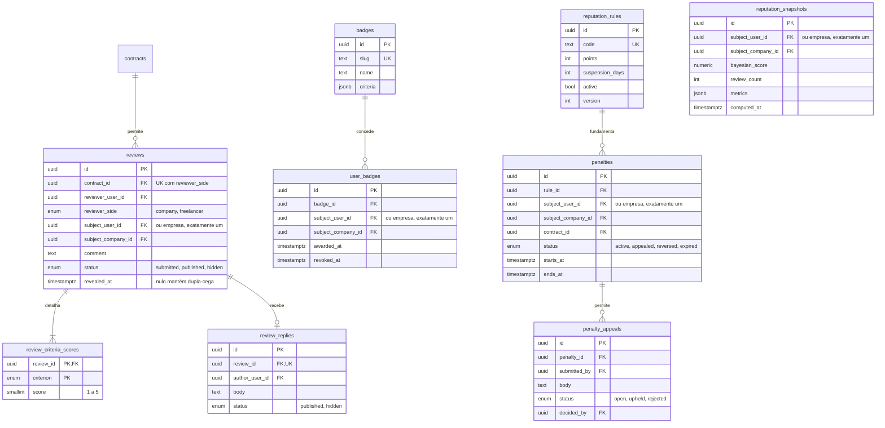

**Plataforma e LGPD**

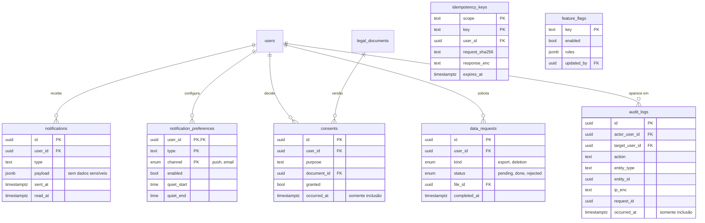

### 6.4 Máquinas de estado

As transições válidas ficam em `packages/shared` e são impostas de novo por gatilho no banco. Toda transição grava uma linha no histórico.

**Contrato**

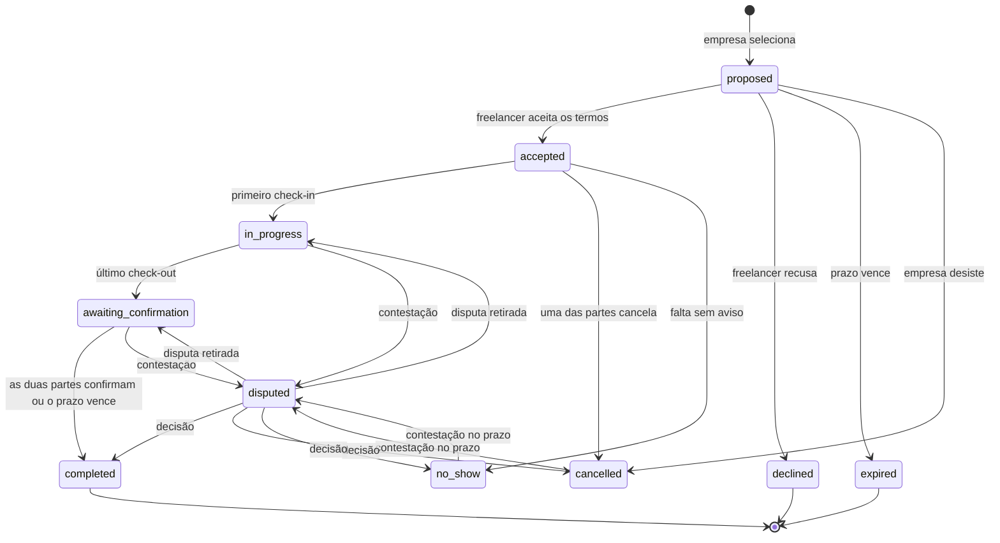

**Disputa**

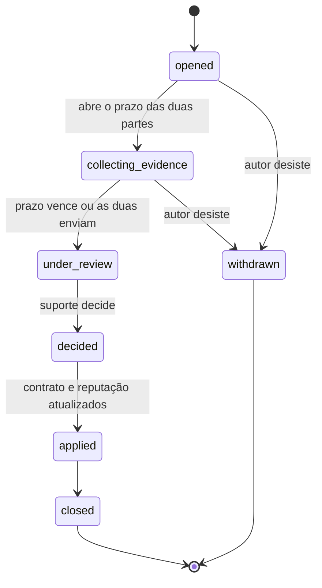

**Demais:**

- **Vaga:** `draft → published → filled | closed | expired | cancelled`, com retorno de `filled` para `published` se uma posição for liberada.
- **Candidatura:** `invited | applied → shortlisted → selected`, ou `rejected | withdrawn | expired`.
- **Chamado:** `open ⇄ pending_user ⇄ pending_support → resolved → closed`.

### 6.5 Quem lê o quê (RLS)

Toda tabela usa `FORCE ROW LEVEL SECURITY`, e o papel da aplicação não tem `BYPASSRLS`. O contexto de cada requisição vem de `set_config('app.user_id', …, true)` dentro de uma transação, o que é seguro com pool de conexões.

| Dados                    | Dono                             | Outra parte                                                   | Terceiros                  | Suporte                                  |
| ------------------------ | -------------------------------- | ------------------------------------------------------------- | -------------------------- | ---------------------------------------- |
| `users` (dados pessoais) | Sim                              | Só nome e telefone, via função auditada, com contrato vigente | Não                        | Sim, com auditoria                       |
| `freelancer_profiles`    | Sim                              | Sim, se houver candidatura ativa                              | Sim, se `discoverable`     | Sim                                      |
| `job_private_details`    | Membros da empresa               | Freelancer com contrato vigente                               | Não                        | Sim, com auditoria                       |
| `applications`           | Freelancer e empresa da vaga     |                                                               | Não                        | Sim, com auditoria                       |
| `messages`               | Participantes                    |                                                               | Não                        | Só em disputa ou denúncia, com auditoria |
| `reviews`                | Autor sempre                     | Só depois de `revealed_at`                                    | Só depois de `revealed_at` | Sim                                      |
| `check_ins`              | Freelancer                       | Empresa do contrato                                           | Não                        | Em disputa, com auditoria                |
| `audit_logs`             | Vê os acessos aos próprios dados |                                                               | Não                        | Só admin. Ninguém altera                 |

**Papéis de banco:** `escala_migrator` (dono do esquema), `escala_app` (API), `escala_auth` (login, [ADR-0011](adr/0011-papel-de-banco-para-o-login.md)), `escala_worker` (tarefas), `escala_support` (painel) e `escala_analytics` (somente visões sem dados pessoais).

### 6.6 Criptografia, retenção e índices

**Criptografia** ([ADR-0006](adr/0006-criptografia-por-campo.md)): AES-256-GCM na aplicação, com contexto do campo como dado autenticado e chave de dados protegida por KMS. CPF, CNPJ, e-mail, telefone, nome legal, endereços, conversas e IPs ficam cifrados. Índice cego por HMAC para busca exata e unicidade.

| Dado                                  | Retenção proposta                                                                 |
| ------------------------------------- | --------------------------------------------------------------------------------- |
| Códigos de uso único                  | Até 1 hora                                                                        |
| Contato e endereço para a outra parte | Até 30 dias depois do turno, como no protótipo                                    |
| Local preciso de check-in             | 90 dias depois do turno ou até fechar a disputa. Depois fica só `within_geofence` |
| Mensagens                             | 12 meses depois do contrato, ou até fechar a disputa                              |
| Registros de acesso                   | 6 meses (Marco Civil, art. 15)                                                    |
| Comprovantes de consentimento         | A definir com o jurídico (sugestão: 5 anos depois do fim da conta)                |
| Imagens de identidade                 | Não ficam conosco. Guardamos só status e referência do provedor                   |

**Índices por consulta real:**

| Consulta               | Índice                                                                 |
| ---------------------- | ---------------------------------------------------------------------- |
| Vagas perto de mim     | GiST em `jobs.public_location`, parcial em `status = 'published'`      |
| Vagas por data         | `jobs (status, starts_at)`                                             |
| Talentos perto         | GiST em `freelancer_profiles.base_location`, parcial em `discoverable` |
| Painel da empresa      | `jobs (company_id, starts_at DESC)`                                    |
| Candidaturas da vaga   | `applications (job_id, status)`                                        |
| Mensagens da conversa  | `messages (conversation_id, id DESC)`, ordenável por ser UUID v7       |
| Notificações não lidas | `notifications (user_id)`, parcial em `read_at IS NULL`                |
| Avaliações publicadas  | `reviews (subject_user_id, revealed_at)` e o equivalente para empresa  |
| Fila do suporte        | `support_tickets (status, priority, sla_due_at)`                       |
| Busca na ajuda         | GIN em `help_articles.search_vector`                                   |

Toda coluna usada em política RLS recebe índice, porque a política roda a cada linha.

## 7. Autenticação

| Provedor            | Como funciona                                                                                                                               | Cuidados                                                                                                                                                          |
| ------------------- | ------------------------------------------------------------------------------------------------------------------------------------------- | ----------------------------------------------------------------------------------------------------------------------------------------------------------------- |
| **Apple**           | Login nativo com `nonce`. A API valida o `id_token`                                                                                         | O e-mail real e o nome só vêm no primeiro login. Tratar Hide My Email e registrar o domínio de envio no Private Email Relay. Revogar o token na exclusão da conta |
| **Google**          | Login nativo com `nonce`. A API valida o `id_token`                                                                                         | Exigir `email_verified`                                                                                                                                           |
| **LinkedIn**        | Mediado pela API: o navegador do sistema abre a API, que troca o código usando o segredo e descarta os tokens. App e API usam PKCE entre si | O PKCE nativo do LinkedIn precisa ser liberado por eles. O login não verifica identidade, então não concede selo                                                  |
| **E-mail e código** | Código de 6 dígitos, com a mesma proteção do protótipo                                                                                      | A resposta é igual exista ou não a conta. O código nunca vai no assunto                                                                                           |

- **Validação no backend:** assinatura, `aud`, `iss`, `exp` e `nonce`.
- **Vinculação de identidades:** só com sessão autenticada ou prova por código. E-mail igual nunca vincula sozinho, para evitar sequestro de conta.
- **Tokens:** acesso de 15 minutos e renovação rotativa, guardada só como hash. Reuso de token revoga a sessão. No aparelho, o token fica no `expo-secure-store`, nunca em AsyncStorage.
- **Tokens de redes sociais:** não são guardados no servidor, conforme a regra 5.1.1(v) da Apple. A exceção é o token da Apple necessário para revogar o acesso na exclusão.
- **Biometria:** `expo-local-authentication` para reabrir o app e confirmar ações sensíveis.
- **Papéis:** freelancer, membro de empresa (`owner`, `admin`, `recruiter`), suporte e admin. Autorização checada em todo endpoint.
- **Proteções:** limite por IP e por conta, bloqueio progressivo, aviso de novo aparelho e 2FA por TOTP com códigos de recuperação. 2FA é opcional, mas obrigatório para admins e donos de empresa.
- **Onboarding:** CPF e data de nascimento para freelancer, e CNPJ para empresa, com consulta por interface e mock ([ADR-0008](adr/0008-verificacao-de-identidade.md)).

A Apple hoje exige um login "equivalente" que proteja a privacidade, e não necessariamente o Sign in with Apple, como diz o prompt. A decisão não muda: oferecer o da Apple cumpre a regra.

## 8. Regras de produto

### 8.1 Comunicação

Chat por candidatura e contrato com texto, imagem, arquivo, áudio curto, entrega, leitura e digitação. Mensagens do sistema registram contrato aceito, check-in e pagamento marcado. Antes do contrato, telefones, e-mails e links de contato são mascarados no servidor, como no protótipo, e a pessoa recebe a explicação. Há denúncia, bloqueio e filtro de ofensas, com retenção para disputas.

### 8.2 O combinado e o pagamento fora do app

1. O contrato registra valor, unidade e data combinada para o pagamento.
2. O contrato e a tela deixam claro: "O Escala não processa nem garante este pagamento."
3. Depois do turno, a empresa marca "paguei" e o freelancer marca "recebi".
4. "Pagamentos em dia" e o selo "pagadora rápida" contam só as confirmações do freelancer.
5. Se não houver confirmação no prazo, o freelancer pode abrir uma disputa. A decisão só afeta reputação e penalidades.

### 8.3 Avaliações e reputação

- **Quem avalia:** só partes de contrato `completed`.
- **Dupla-cega:** a nota só aparece quando as duas partes avaliam ou quando fecham os 7 dias. O bloqueio é feito também por RLS.
- **Critérios:** para freelancer, pontualidade, qualidade, comunicação e postura. Para empresa, clareza da vaga, ambiente, pagamento em dia e respeito. Comentário opcional e direito de resposta.
- **Cálculo:** média bayesiana com peso maior para avaliações recentes e mínimo de avaliações para exibir a nota. Teste obrigatório: uma avaliação de 5 estrelas não supera 50 de 4,8.
- **Contra conluio, agora mais importante:**
  - Exigir check-in dentro da geocerca para o contrato contar.
  - Reduzir o peso de avaliações repetidas entre o mesmo par.
  - Dar menos peso a empresas sem CNPJ verificado.
  - Sinalizar padrões suspeitos ao suporte.
- **Penalidades:** configuráveis em `reputation_rules`, com direito a recurso, em `docs/REPUTATION_RULES.md`.

### 8.4 Suporte, disputas e segurança pessoal

FAQ pesquisável, chamados com SLA, disputa com prazos e painel interno com trilha de auditoria. O botão de emergência liga para o 190 e abre um alerta urgente para o suporte. O local só é enviado quando a pessoa toca no botão. O app não aciona a polícia por conta própria.

### 8.5 Privacidade na escolha de candidatos

O protótipo não mostra foto antes da contratação, para reduzir discriminação. O prompt pede foto de perfil. Proposta: foto opcional, visível para empresas só depois da pré-seleção (decisão D3).

### 8.6 Métricas

`docs/METRICS.md`, na Fase 4: ativação, tempo até a primeira contratação, taxa de preenchimento de vagas, recontratação, NPS, taxa de disputas, contratos concluídos e valor combinado registrado.

## 9. Design e UX

`docs/UX_FLOWS.md`, em Mermaid, antes das telas: onboarding, publicar vaga, candidatura, contratação e registro do combinado, execução com check-in, conclusão e avaliação, disputa e suporte.

- **iOS:** Liquid Glass via `expo-glass-effect`, com alternativa opaca quando indisponível ou com "reduzir transparência" ativo.
- **Android:** Material 3 via Expo UI e Jetpack Compose. O material do Expo não menciona Material 3 Expressive, então esse nível é uma aproximação a validar na Fase 3.
- **Navegação:** abas nativas do Expo Router, estáveis no SDK 58.
- **Design system:** tokens, modo claro e escuro e componentes em `packages/ui`, a partir da Fase 3. A Fase 9 aplica e revisa tudo, para evitar retrabalho no fim.
- **Toda tela:** carregando, vazio com ação sugerida, erro com recuperação, e sucesso.
- **Acessibilidade:** WCAG 2.2 AA, "reduzir movimento" respeitado e modo offline básico.

## 10. Segurança e qualidade

Referências: OWASP ASVS e Mobile Top 10.

| Área              | Plano                                                                                                                          |
| ----------------- | ------------------------------------------------------------------------------------------------------------------------------ |
| Entrada           | Schemas Zod compartilhados entre app e API                                                                                     |
| Transporte        | TLS 1.2 ou superior, cabeçalhos de segurança e CORS restrito. O painel usa o CSP e as defesas de CSRF já testadas no protótipo |
| Uploads           | Tipo e tamanho validados, varredura de malware e URLs expiráveis. O arquivo só é liberado com `scan_status = clean`            |
| Aparelho          | App Attest e Play Integrity conferidos no servidor. Detecção de root e jailbreak só como sinal de risco, porque é contornável  |
| Dependências      | Auditoria no CI, Dependabot e varredura de segredos                                                                            |
| Logs              | Sem dados pessoais, com máscara para CPF, e-mail e telefone                                                                    |
| Modelo de ameaças | `docs/SECURITY.md`, começa na Fase 1 e fecha na Fase 10                                                                        |

| Teste               | Ferramenta                         | Cobertura                                                    |
| ------------------- | ---------------------------------- | ------------------------------------------------------------ |
| Unidade             | Vitest                             | Reputação e máquinas de estado                               |
| Integração          | Testcontainers com PostgreSQL real | API e banco, incluindo testes de RLS como `escala_app`       |
| Autorização         | Testcontainers                     | Matriz da seção 6.5: cada papel tenta acessar dados de outro |
| E2E                 | Maestro                            | Fluxos críticos no app                                       |
| Cobertura mínima    |                                    | 80% em auth, reputação, máquinas de estado e autorização     |
| Documentação da API | OpenAPI gerado                     |                                                              |

## 11. Fases

Ao fim de cada fase: lint, typecheck, testes, commit convencional e resumo para você. P, M e G indicam o tamanho relativo.

| Fase   | Entrega                                                                                                                                                    | Pronto quando                                                 | Tamanho | Depende de você                         |
| ------ | ---------------------------------------------------------------------------------------------------------------------------------------------------------- | ------------------------------------------------------------- | ------- | --------------------------------------- |
| **0**  | Leitura, este plano, ER e ADRs                                                                                                                             | Sua aprovação                                                 | P       | Aprovar                                 |
| **1**  | Monorepo, protótipo em `legacy/`, Expo e NestJS iniciais, lint, CI, Docker Compose, `.env.example`, `CLAUDE.md`, `LEGAL_TODO.md` e início do `SECURITY.md` | CI verde                                                      | M       | Repositório remoto (D4)                 |
| **2**  | Migrações up e down, papéis, RLS, criptografia, seeds, `DATA_DICTIONARY.md`                                                                                | Migrações sobem e descem, e testes de RLS passam              | G       | Docker ligado                           |
| **3**  | `UX_FLOWS.md`, tokens, login nos 3 provedores e por código, 2FA, biometria, RBAC, onboarding e central de privacidade                                      | Login nos 3 provedores em dev                                 | G       | Credenciais. Sem elas, entrega com mock |
| **4**  | Perfis, vagas, busca geográfica, candidatura, contrato, registro do combinado, turnos, check-in e `METRICS.md`                                             | Fluxo publicar, contratar, executar e concluir ponta a ponta  | G       |                                         |
| **5**  | **Cancelada**                                                                                                                                              |                                                               |         |                                         |
| **6**  | Chat em tempo real, anexos, áudio, push, preferências, denúncia, bloqueio e moderação                                                                      | Mensagens em tempo real entre 2 aparelhos                     | G       | Contas de push para aparelho físico     |
| **7**  | Avaliações, reputação, ranking, selos, penalidades e `REPUTATION_RULES.md`                                                                                 | Testes das regras de reputação passando                       | M       |                                         |
| **8**  | Ajuda, chamados, disputas, botão de emergência e painel interno                                                                                            | Disputa decidida atualiza contrato e reputação, com auditoria | G       |                                         |
| **9**  | Design system em todas as telas, acessibilidade, offline, polimento e remoção de `legacy/`                                                                 | Revisão de todos os estados de tela                           | M       |                                         |
| **10** | Hardening, observabilidade, restauração de backup documentada, versão mínima, deep links e build EAS                                                       | Checklist do `SECURITY.md` completo                           | G       | Infraestrutura e lojas (D5, D6)         |

**Sem provisionar nada por conta própria:** até a Fase 9, tudo roda em Docker Compose. Hospedagem só com sua aprovação na Fase 10.

## 12. Decisões em aberto

Se você aprovar sem comentários, sigo com a recomendação de cada uma.

| #      | Decisão                                                        | Recomendação                                                                                                                         | Até quando             |
| ------ | -------------------------------------------------------------- | ------------------------------------------------------------------------------------------------------------------------------------ | ---------------------- |
| **D1** | Como o Escala ganha dinheiro sem pagamentos no app?            | Gratuito no piloto. Decidir depois de ter uso real. Cobrar por recurso digital dentro do app pode exigir compra da Apple e do Google | Antes do lançamento    |
| **D2** | Manter "paguei" e "recebi" para alimentar "pagamentos em dia"? | Sim. Não movimenta dinheiro e mantém a reputação da empresa útil                                                                     | Fase 4                 |
| **D3** | Quando mostrar a foto do freelancer?                           | Foto opcional, visível só depois da pré-seleção                                                                                      | Fase 4                 |
| **D4** | Onde fica o repositório remoto?                                | Criar um repositório privado no GitHub. O `gh` não está instalado aqui                                                               | Fase 1                 |
| **D5** | Onde hospedar?                                                 | AWS em São Paulo (`sa-east-1`), para manter dados no Brasil. Confirmar PostgreSQL 18 na região                                       | Fase 10                |
| **D6** | Quem é o controlador dos dados?                                | Precisa de empresa com CNPJ, que também abre as contas da Apple e do Google                                                          | Fase 3, para os termos |
| **D7** | Qual provedor para CPF e CNPJ?                                 | Interface com mock agora. Serpro ou equivalente em produção                                                                          | Fase 10                |
| **D8** | Exigir verificação de identidade com selfie?                   | Não. Selo opcional ([ADR-0008](adr/0008-verificacao-de-identidade.md))                                                               | Fase 3                 |

## 13. Riscos

| Risco                    | Efeito                                                                                                                                                                                                             | Como tratar                                                                                                        |
| ------------------------ | ------------------------------------------------------------------------------------------------------------------------------------------------------------------------------------------------------------------ | ------------------------------------------------------------------------------------------------------------------ |
| **Vínculo empregatício** | Check-in com geolocalização, ranking e penalidades podem indicar subordinação. O STF (Tema 1291) e o PLP 152/2025 seguiam sem definição nas fontes de agosto de 2026, e o debate foca em motoristas e entregadores | Sem escala imposta, com recusa livre e sem punição por recusar. `LEGAL_TODO.md` e revisão jurídica antes de lançar |
| **Trabalho de menores**  | Turno noturno e bebida alcoólica. A Constituição proíbe trabalho noturno a menores de 18 anos                                                                                                                      | CPF e data de nascimento conferidos antes do primeiro contrato                                                     |
| **ECA Digital**          | Decreto 12.880/2026 e orientações da ANPD ainda em evolução. Autodeclaração é vedada para conteúdo proibido a menores                                                                                              | Não depender só de autodeclaração. Validar o enquadramento com o jurídico                                          |
| **Dados sensíveis**      | Biometria é dado sensível (LGPD, arts. 5º, II e 11), e a ANPD pede cautela                                                                                                                                         | Sem biometria obrigatória. Imagens ficam no provedor                                                               |
| **Calote fora do app**   | Frustração e perda de confiança                                                                                                                                                                                    | Aviso explícito, reputação e disputa. Sem promessa de garantia                                                     |
| **Reputação inflada**    | Contrato falso custa pouco                                                                                                                                                                                         | Proteções da seção 8.3                                                                                             |
| **Geolocalização**       | Dado pessoal de rotina                                                                                                                                                                                             | Só no check-in, nunca contínua, com retenção curta                                                                 |
| **Ferramentas novas**    | Drizzle ainda em 0.x                                                                                                                                                                                               | Isolar o acesso a dados                                                                                            |
| **Tamanho do projeto**   | Muitas frentes antes de testar com usuários                                                                                                                                                                        | Usar a Fase 4 como marco e considerar um piloto fechado com poucas empresas                                        |
| **Nome**                 | "Escala" pode já estar registrado                                                                                                                                                                                  | Busca no INPI antes de investir na marca                                                                           |

## 14. O que preciso de você

**Para aprovar agora:** este plano e as recomendações da seção 12.

**Quando chegar a fase:**

| Item                                               | Fase                | Sem isso                                    |
| -------------------------------------------------- | ------------------- | ------------------------------------------- |
| Docker Desktop ligado (instalado, mas parado hoje) | 2                   | Testes de banco não rodam                   |
| Repositório no GitHub                              | 1                   | "CI verde" só pode ser conferido localmente |
| Google Cloud OAuth e app no LinkedIn Developers    | 3                   | Mock                                        |
| Apple Developer                                    | 3                   | Mock. Conta de empresa exige CNPJ e D-U-N-S |
| Provedor de e-mail com SPF, DKIM e DMARC           | 3                   | Caixa simulada                              |
| Conta Expo e EAS                                   | 6                   | Sem push em aparelho físico                 |
| Google Play Console                                | 10                  | Sem publicação                              |
| Hospedagem e KMS                                   | 10                  | Só ambiente local                           |
| Advogado (trabalhista, LGPD, termos)               | Antes do lançamento | Sem lançamento público                      |

## 15. Cobertura dos requisitos

| Prompt                   | Onde está                                                                                                                                                 |
| ------------------------ | --------------------------------------------------------------------------------------------------------------------------------------------------------- |
| §0 Regras de execução    | Fases, ADRs e [ASSUMPTIONS.md](ASSUMPTIONS.md)                                                                                                            |
| §1 Stack                 | Seção 4                                                                                                                                                   |
| §2.1 Princípios de dados | Seções 6.1, 6.4 e 6.6                                                                                                                                     |
| §2.2 Segurança de dados  | Seções 6.5 e 6.6, [ADR-0005](adr/0005-autorizacao-rbac-e-rls.md) e [ADR-0006](adr/0006-criptografia-por-campo.md). PITR e teste de restauração na Fase 10 |
| §2.3 Entidades           | Seção 6.3                                                                                                                                                 |
| §3 Autenticação          | Seção 7                                                                                                                                                   |
| §4 Pagamentos            | **Removida** (seção 2)                                                                                                                                    |
| §5.1 Comunicação         | Seção 8.1, Fase 6                                                                                                                                         |
| §5.2 Suporte             | Seção 8.4, Fase 8                                                                                                                                         |
| §5.3 Perfis e ranking    | Seções 6.3 e 8.2, fases 4 e 7                                                                                                                             |
| §5.4 Avaliações          | Seção 8.3, Fase 7                                                                                                                                         |
| §5.5 Pontos de PM        | Seções 8.6, 9 e 13, fases 1, 4, 9 e 10                                                                                                                    |
| §6 Design                | Seção 9                                                                                                                                                   |
| §7 Segurança             | Seção 10, Fase 10                                                                                                                                         |
| §8 Testes                | Seção 10                                                                                                                                                  |
| §9 Fases                 | Seção 11                                                                                                                                                  |

**Acrescentei ao que o prompt pediu**, porque o modelo precisa:

| Tabela                                       | Motivo                                                       |
| -------------------------------------------- | ------------------------------------------------------------ |
| `job_private_details`                        | RLS atua por linha. Endereço exato precisa de tabela própria |
| `refresh_tokens`, `otp_codes`, `mfa_factors` | Rotação de token, login por código e 2FA                     |
| `files`                                      | Varredura de malware e URLs assinadas em um só lugar         |
| `favorites`                                  | "Favoritos" e "recontratar"                                  |
| `legal_documents`                            | Termos versionados                                           |
| `user_blocks`                                | Bloqueio de usuário                                          |
| `help_articles`                              | FAQ pesquisável                                              |
| `safety_alerts`                              | Botão de emergência                                          |
| `reputation_rules`, `penalty_appeals`        | Regras configuráveis e direito a recurso                     |
| `data_requests`                              | Pedidos da LGPD                                              |
| `*_status_history`                           | Histórico de transições                                      |

## 16. Fontes

Consultadas em 04/11/2026. Versões vieram do npm. Conferir normas e documentos oficiais antes de decisões jurídicas: várias fontes legais são secundárias.

- **Apple:** [App Review Guidelines](https://developer.apple.com/app-store/review/guidelines/) (4.8, 5.1.1(v), 3.1.3)
- **Expo:** [SDK 58](https://expo.dev/changelog/sdk-58)
- **LinkedIn:** [OpenID Connect](https://learn.microsoft.com/en-us/linkedin/consumer/integrations/self-serve/sign-in-with-linkedin-v2) e [OAuth para clientes nativos](https://learn.microsoft.com/en-us/linkedin/shared/authentication/authorization-code-flow-native). Parte desse material é antiga: confirmar na Fase 3
- **Drizzle:** [RLS](https://orm.drizzle.team/docs/rls), [migrações](https://orm.drizzle.team/docs/migrations) e [PostGIS](https://orm.drizzle.team/docs/guides/postgis-geometry-point)
- **PostgreSQL no RDS:** [suporte à versão 18](https://www.amazonaws.cn/en/new/2025/amazon-rds-for-postgresql-supports-major-version-18/) e [PostGIS 3.6.3](https://www.amazonaws.cn/new/2026/amazon-rds-for-postgresql-supports-minor-versions/). A região `sa-east-1` não foi confirmada
- **NestJS:** [guia de migração](https://docs.nestjs.com/migration-guide)
- **Relação de trabalho:** [STF adia análise da uberização (Conjur)](https://conjur.com.br/2026-jun-24/stf-adia-julgamento-da-uberizacao-para-analisar-nova-convencao-da-oit-2/), [PLP 152/2025 (Câmara)](https://www.camara.leg.br/noticias/1231812-votacao-sobre-regras-para-trabalho-por-aplicativo-e-adiada-parecer-mantem-autonomia-e-cria-garantias/)
- **ECA Digital:** [regras (Agência Gov)](https://agenciagov.ebc.com.br/noticias/202608/eca-digital-conheca-as-regras-de-protecao-de-criancas-e-adolescentes-no-ambiente-online), [orientações da ANPD (L. O. Baptista)](https://www.baptista.com.br/o-que-o-eca-digital-e-as-orientacoes-preliminares-da-anpd-significam-para-o-seu-negocio/), [decreto (CSMV)](https://www.csmv.com.br/boletins/eca-digital-e-regulamentado-e-anpd-publica-orientacoes-sobre-verificacao-etaria/)
