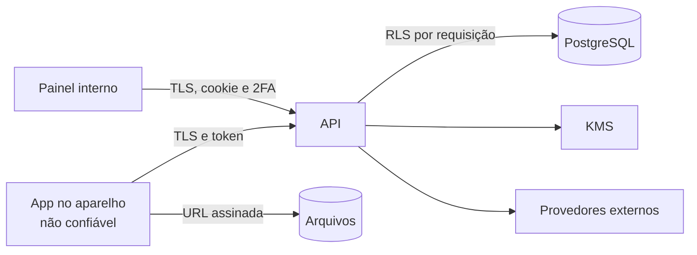

# Segurança

Modelo de ameaças e checklist do produto novo. Começa na Fase 1 e fecha na Fase 10. O que já foi testado no protótipo está em [SEGURANCA.md](../legacy/prototype/docs/SEGURANCA.md), e aqueles cenários serão portados para a nova API.

Referências: OWASP ASVS e OWASP Mobile Top 10.

## O que protegemos

| Ativo                  | Exemplos                                  | Impacto se vazar          |
| ---------------------- | ----------------------------------------- | ------------------------- |
| Dados de identificação | CPF, CNPJ, data de nascimento, nome legal | Fraude e exposição legal  |
| Contato                | E-mail, telefone, endereço do turno       | Assédio e risco físico    |
| Conversas e anexos     | Mensagens, áudio, documentos              | Exposição de vida privada |
| Local de trabalho      | Check-in com geolocalização               | Risco físico e vigilância |
| Reputação              | Notas, penalidades                        | Dano profissional         |
| Sessões e chaves       | Tokens, chaves de cifra, segredos         | Acesso a tudo acima       |

## Quem pode atacar

- **Pessoa de fora:** contas falsas, coleta em massa, força bruta.
- **Usuário legítimo:** acessar dados de outro, inflar reputação, assediar.
- **Empresa falsa:** usar vagas para coletar dados ou aplicar golpes.
- **Interno:** suporte ou administrador abusando do acesso.
- **Cadeia de suprimentos:** pacote comprometido.
- **Aparelho comprometido:** root, jailbreak ou app alterado.

## Fronteiras de confiança

Nada vindo do app é confiável: toda regra é repetida no servidor.

## Ameaças e defesas

| Ameaça                             | Defesa                                                                                             | Situação         |
| ---------------------------------- | -------------------------------------------------------------------------------------------------- | ---------------- |
| Entrada maliciosa ou campos extras | `ZodPipe` com schemas estritos                                                                     | Pronto na Fase 1 |
| Resposta com dado a mais           | `@ResponseSchema` e teste que exige schema em toda rota                                            | Pronto na Fase 1 |
| Dados pessoais em log              | Log só com método, caminho e status, mais máscara de campos                                        | Pronto na Fase 1 |
| Configuração insegura              | Validação na subida, sem curinga de CORS e https em produção                                       | Pronto na Fase 1 |
| Cabeçalhos e corpo excessivo       | Helmet, CSP de negar tudo e limite de 64 KB                                                        | Pronto na Fase 1 |
| Dependência comprometida           | Lockfile, scripts de instalação bloqueados, idade mínima de versão, auditoria no CI, Dependabot    | Pronto na Fase 1 |
| Segredo no repositório             | `.gitignore`, `.env` gerado localmente, varredura no CI                                            | Pronto na Fase 1 |
| Ação de CI adulterada              | Ações fixadas por SHA e permissão só de leitura                                                    | Pronto na Fase 1 |
| Acesso a dados de outra conta      | RBAC e RLS ([ADR-0005](adr/0005-autorizacao-rbac-e-rls.md))                                        | Fase 2           |
| Roubo do banco                     | Criptografia por campo ([ADR-0006](adr/0006-criptografia-por-campo.md))                            | Fase 2           |
| Sequestro de conta                 | Sem senha, rotação de token e vínculo protegido ([ADR-0007](adr/0007-login-sem-senha-e-tokens.md)) | Fase 3           |
| Força bruta e abuso                | Limite por IP e por conta, bloqueio progressivo                                                    | Fase 3           |
| Uso indevido do contato            | Liberação só em contrato vigente, por 30 dias, com auditoria                                       | Fase 4           |
| Coleta em massa de perfis          | Fora das buscas por padrão, nome abreviado e limites                                               | Fase 4           |
| Arquivo malicioso                  | Tipo e tamanho validados, varredura e URLs expiráveis                                              | Fase 4           |
| Assédio no chat                    | Máscara de contato, denúncia, bloqueio e retenção                                                  | Fase 6           |
| Reputação fraudada                 | Check-in válido e peso menor para pares repetidos                                                  | Fase 7           |
| Abuso por interno                  | Permissões mínimas, 2FA e auditoria somente de inclusão                                            | Fase 8           |
| App adulterado                     | App Attest, Play Integrity e versão mínima                                                         | Fase 10          |

## Checklist da Fase 10

- [ ] Modelo de ameaças revisado
- [ ] Todos os cenários do protótipo portados e passando
- [ ] Matriz de autorização testada com o papel real do banco
- [ ] TLS 1.2 ou superior em todos os ambientes
- [ ] Segredos em cofre, com rotação documentada
- [ ] Backup com PITR e restauração testada
- [ ] Logs revisados em busca de dados pessoais
- [ ] Observabilidade e alertas ativos
- [ ] Plano de resposta a incidentes testado
- [ ] Teste de invasão independente
